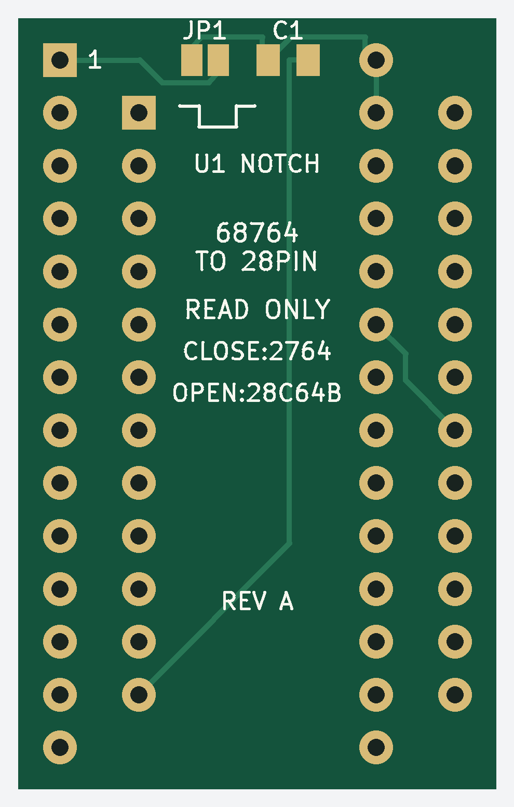

# 2364 / 68764 ROM adapter

A compact **23 × 37 mm** adapter for replacing a 24-pin, active-low-select
2364 or MCM68764 ROM with a **28-pin AT28C64B EEPROM or 5 V 2764/27C64 EPROM**.
Designed by **Jon Guidry / hexbus** for the TI-99/4A Hexbus interface.

All 13 address lines and 8 data lines pass through without rearranging the
ROM image. Host pin 20 drives both `/CE` and `/OE`; replacement pin 27 is
held high to disable writing/programming. Program the memory separately.

## Top and bottom

| Top — components and ROM socket | Bottom — pins toward the host |
| --- | --- |
|  |  |

Previews show the delivered Gerbers; the bottom is viewed from underneath.
**C1, JP1 and `U1 NOTCH` identify the top. `J1 TO HOST` identifies the bottom.**
Each connector has its own square pin-1 pad; their positions are offset.
Both notch ends face the same end of the board.

[Photo of the first bare boards](images/first-boards.jpg): top on the left,
bottom on the right. Those boards predate the printed designer credit.
For my own batches, I also use JLCPCB's order-time QR option for identifiers
such as `JDG001`–`JDG025`. Public Gerbers include permanent
`hexbus.com (c) 2026` credit so boards made by others are identified too.

## Files and fabrication

- **[Gerber ZIP — Rev A, 9 November 2026](gerbers/2364-adapter-rev-a-20261109.zip)**
- [KiCad 10 project](hardware/68764-to-28pin.kicad_pro),
  [schematic](hardware/68764-to-28pin.kicad_sch) and [BOM](hardware/bom.csv)

Order **2 layers, 1.6 mm FR4, 1 oz copper, 23 × 37 mm**, with solder mask
on both sides and HASL or ENIG finish. Component holes are specified as
**0.80 mm plated through holes**. Minimum track width is 0.25 mm; design
clearance is 0.20 mm. No stencil or assembly files are included.

This package retains the October 21 mask correction, adds bottom designer
credit and moves C1/JP1 labels clear of the mask openings. Copper, masks,
drill geometry and outline match corrected Rev A. **Do not fabricate the
original October 19 package:** its connector pads lacked mask openings.

## JP1 and C1

| Installed memory | JP1 | Effect |
| --- | --- | --- |
| AT28C64B, DIP28 | **OPEN** | Pin 1 isolated; pin 27 `/WE` held high |
| 5 V 2764 / 27C64, DIP28 | **CLOSED** with solder | Pin 1 VPP at +5 V for reading; pin 27 `/PGM` high |

**C1: 100 nF (0.1 µF), 0805 ceramic, X7R or X5R, at least 16 V.**
It bypasses +5 V to ground and is nonpolarized: either orientation is correct.
Change JP1 only with power removed. Other EEPROM models need their exact
datasheet checked; this does not cover every part called “2864.”

## Assembly

1. Solder C1 and set JP1 first; the memory body will cover them.
2. Fit **two 1×12 round-pin male strips underneath**, pins pointing toward
   the host; solder from above. Use socket-compatible mating pins around
   0.45–0.50 mm diameter, not thick square headers.
3. Fit **two 1×14 female socket strips on top**, 2.54 mm pitch and 15.24 mm
   between rows; solder underneath. A closed-base DIP socket can foul the
   other connector's solder tails, so use separate strips.
4. Keep top tails at least 0.5 mm below the memory body and underside tails
   at least 0.5 mm clear of exposed metal in the host. Check actual strip
   dimensions, pin engagement and enclosure clearance before seating.
5. With no memory installed, check the pin map below. J1 pins 24 and 12 must
   have no sustained short; C1 may cause a brief meter response.
6. Program and verify the memory separately, then insert it with U1 pin 1
   at its square pad. With host power off, align J1 pin 1 with the original
   socket's pin 1. Check clearance and do not force it.

Never apply programming voltage through the 24-pin host connector.

## Pinout and continuity checks

Package pin numbers are **viewed from the top**. The bottom footprint is
already flipped correctly in CAD; do not reverse its numbering again.
Grouped entries correspond in the order shown.

| J1: 2364 / 68764 host | Signal | U1: 28-pin memory |
| --- | --- | --- |
| 1–8 | A7, A6, A5, A4, A3, A2, A1, A0 | 3–10 |
| 9–11 | D0, D1, D2 | 11–13 |
| 12 | Ground | 14; C1 ground pad |
| 13–17 | D3, D4, D5, D6, D7 | 15–19 |
| 18 | A11 | 23 |
| 19 | A10 | 21 |
| 20 | Active-low select | 20 (`/CE`) and 22 (`/OE`) |
| 21 | A12 | 2 |
| 22 | A9 | 24 |
| 23 | A8 | 25 |
| 24 | +5 V | 28 and 27; also 1 if JP1 closed |
| No host connection | U1 pin 1 | JP1 pad 2; isolated from VCC if open |
| No host connection | U1 pin 26 | Unconnected |

Verify U1 pins **20/22 connect to J1 pin 20, not ground**; pin **27 connects
to +5 V**; and pin **1 follows the JP1 setting**.

## Compatibility and checks

Use a 5 V host socket with the pinout above and active-low select on pin 20.
The C64's separate BASIC (901226) and KERNAL (901227) 2364 sockets are
electrical candidates, but fit and operation with this board are untested.
Other 23xx ROMs, 2332 character ROMs, different select polarities and later
combined 28-pin ROMs require separate checks. The adapter cannot supply a
missing host address bit or repair 4K-only decoding.

ERC/DRC, independent pin mapping, exported copper/masks/outline/drills and
the exact ZIP were checked; manufacturing layers were rendered and visually
inspected. All 52 connector pads have mask openings on both sides, with four
additional C1/JP1 openings on top. The mask check rejects the original defect.
Bare boards have been fabricated and photographed; assembled continuity,
soldering, fit, timing and host operation remain unverified.

Pin references: [Motorola MCM68764](https://deramp.com/downloads/mfe_archive/050-Component%20Specifications/Motorola/Memory%20Components/Motorola%20MCM68764.pdf),
[Microchip AT28C64B](https://ww1.microchip.com/downloads/aemDocuments/documents/MPD/ProductDocuments/DataSheets/AT28C64B-64-Kbit-8Kx8-Parallel-EEPROM-with-Page-Write-and-Software-Data-Protection-DS20006432.pdf),
[ST M27C64A](https://media.digikey.com/pdf/Data%20Sheets/ST%20Microelectronics%20PDFS/m27c64a_Rev2006.pdf),
[MOS 2364 (printed page 2-112)](https://www.bitsavers.org/pdf/commodore/Commodore_Component_Data_Catalog_1981.pdf).

## License

Copyright © 2026 **Jon Guidry / hexbus**.

[MIT terms with an Additional Attribution Requirement](LICENSE), as used for
my Floppy-FFC-Adapter. Physical reproductions and derivatives must retain
the designer credit on the board itself. Do not remove, obscure or
misrepresent that credit. See the full license for its terms.
