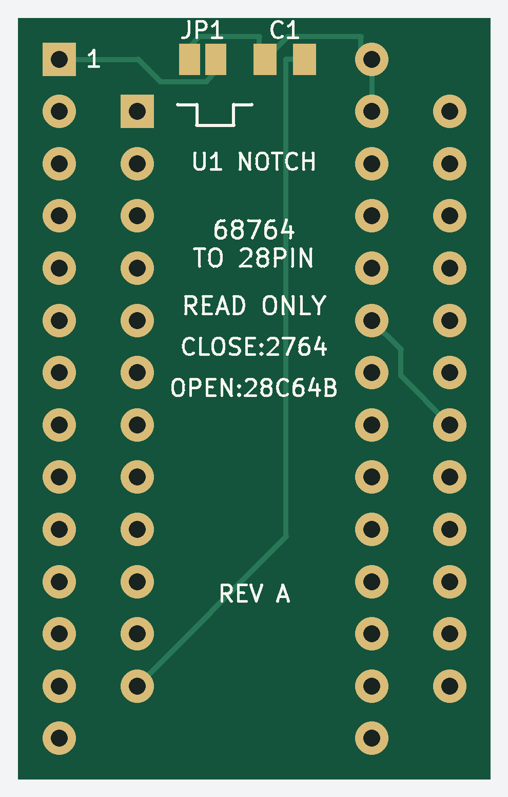
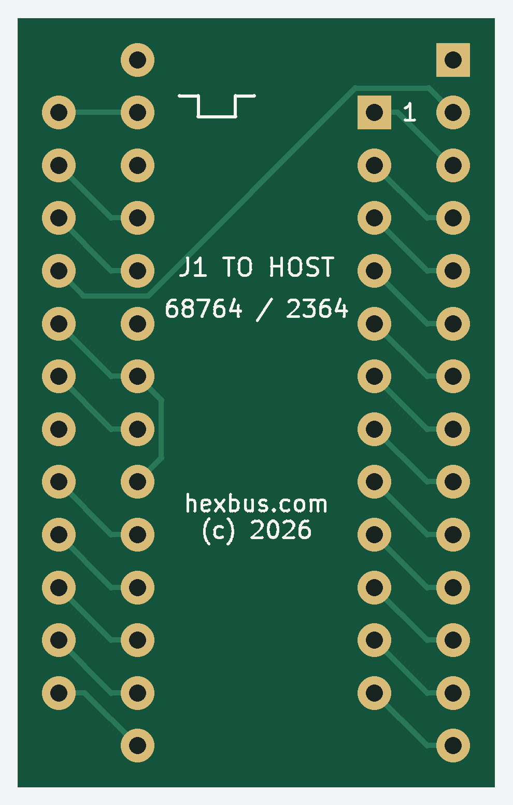

# 2364 / 68764 ROM adapter

A compact **23 × 37 mm** board that replaces a 24-pin, active-low-select
2364 or MCM68764 ROM with a removable **AT28C64B EEPROM or 5 V 2764/27C64 EPROM**.
Designed by **Jon Guidry / hexbus** for the TI-99/4A Hexbus interface.

The adapter carries all 13 address lines and 8 data lines without rearranging
the ROM image. Host pin 20 drives both `/CE` and `/OE`; pin 27 is held high
to disable writing/programming. Program the memory separately in a programmer.

**Status:** bare boards have been fabricated and photographed. CAD and
fabrication-file checks are recorded in [verification](docs/verification.md).
Assembled continuity, mechanical fit, timing and operation remain unverified.

## Top and bottom

| Top — components and ROM socket | Bottom — pins toward the host |
| --- | --- |
|  |  |

These previews are rendered from the fabrication ZIP. The bottom is mirrored
to show the board as viewed from underneath. **C1, JP1 and `U1 NOTCH` identify
the top; `J1 TO HOST` identifies the bottom.** Each connector has its own
square pin-1 pad; the two pin-1 locations are offset. Both notch ends face
the same end of the board.

[Photo of the first bare boards](docs/images/first-boards.jpg): top on the left,
bottom on the right. Those boards predate the designer credit added to the
bottom silkscreen in this repository.

I also use JLCPCB's order-time QR option for identifiers such as `JDG001`
through `JDG025`. That per-board numbering is configured when ordering and
is not generated by these Gerbers. The public CAD and Gerbers carry permanent
`hexbus.com (c) 2026` silkscreen credit so boards made by others are identified too.

## Files and PCB order

- **[Gerber ZIP — Rev A, credit edition, 9 November 2026](fabrication/2364-adapter-rev-a-credit-20261109-gerbers.zip)**
- [Individual Gerbers and drill file](hardware/rev-a/fabrication/)
- [KiCad 10 project](hardware/rev-a/68764-to-28pin.kicad_pro),
  [schematic](hardware/rev-a/68764-to-28pin.kicad_sch),
  [BOM](hardware/bom.csv) and [pin-map CSV](hardware/pin-map.csv)

Order **2 layers, 1.6 mm FR4, 1 oz copper, 23 × 37 mm**, with solder mask
on both sides and HASL or ENIG finish. Component holes are specified as
0.80 mm plated through holes. Minimum track width is 0.25 mm and design
clearance is 0.20 mm. No stencil or assembly files are included.

This edition retains the October 21 solder-mask correction, adds bottom
silkscreen credit and moves the C1/JP1 labels clear of the mask openings.
Copper, drill geometry, outline and mask openings are
unchanged from the corrected Rev A. **Do not use the original October 19
fabrication package:** its connector pads lacked solder-mask openings.

## JP1 and C1

| Installed memory | JP1 | Effect |
| --- | --- | --- |
| AT28C64B, DIP28 | **OPEN** | Pin 1 isolated; pin 27 `/WE` held high |
| 5 V 2764 / 27C64, DIP28 | **CLOSED** with solder | Pin 1 VPP at +5 V for reading; pin 27 `/PGM` high |

Change JP1 only with power removed. Other EEPROM models need their exact
datasheet checked; this is not a universal adapter for every “2864.”

**C1: 100 nF (0.1 µF), 0805 ceramic, X7R or X5R, rated at least 16 V.**
It bypasses +5 V to ground. It is nonpolarized: either orientation is correct.

## Assembly

1. Solder C1 and set JP1 first; the memory body will cover them.
2. Fit **two 1×12 round-pin male strips underneath**, pins pointing toward
   the host board; solder from the top. Use socket-compatible mating pins,
   approximately 0.45–0.50 mm diameter, not thick square headers.
3. Fit **two 1×14 female socket strips on top**, 2.54 mm pitch and 15.24 mm
   between rows; solder underneath. Separate strips avoid the solder-tail
   interference that a closed-base DIP socket can cause.
4. Keep top tails at least 0.5 mm below the memory body. Keep underside
   tails short and at least 0.5 mm clear of exposed metal in the host.
5. With no memory installed, verify the pin map below and check for bridges.
   J1 pins 24 and 12 must have no sustained short; C1 may cause a brief meter response.
6. Program and verify the memory separately. Insert it with U1 pin 1 at its
   square pad. With host power off, align J1 pin 1 with the original socket's
   pin 1 and check clearance before seating. Do not force it.

Never apply programming voltage through the 24-pin host connector.

## Pinout and continuity checks

Package pin numbers are **viewed from the top**. The bottom footprint is
already flipped correctly in CAD; do not reverse its numbering again.
Grouped entries correspond in the order shown.

| J1: 2364 / 68764 host | Signal | U1: 28-pin memory |
| --- | --- | --- |
| 1–8 | A7, A6, A5, A4, A3, A2, A1, A0 | 3–10 |
| 9–11 | D0, D1, D2 | 11–13 |
| 12 | Ground | 14; C1 ground pad |
| 13–17 | D3, D4, D5, D6, D7 | 15–19 |
| 18 | A11 | 23 |
| 19 | A10 | 21 |
| 20 | Active-low select | 20 (`/CE`) and 22 (`/OE`) |
| 21 | A12 | 2 |
| 22 | A9 | 24 |
| 23 | A8 | 25 |
| 24 | +5 V | 28 and 27; also 1 if JP1 closed |
| No host connection | U1 pin 1 | JP1 pad 2; isolated from VCC if open |
| No host connection | U1 pin 26 | Unconnected |

In particular, verify U1 pins **20/22 connect to J1 pin 20, not ground**,
U1 pin **27 connects to +5 V**, and U1 pin **1 follows the JP1 setting**.

## Compatibility

Use a 5 V socket with the pinout above and active-low select on pin 20.
The separate C64 BASIC (901226) and KERNAL (901227) 2364 sockets are electrical
candidates; fit and operation with this board have not been tested. A 2332
character ROM, other select polarities, and later combined 28-pin ROMs are
not covered by that compatibility claim.

The adapter cannot supply an address signal missing from the host or fix
4K-only decoding. The TI Hexbus interface's full 8K addressing remains a
separate host-level question.

## License and credit

Copyright © 2026 **Jon Guidry / hexbus**.

Released under [MIT terms with an Additional Attribution Requirement](LICENSE),
the same hardware license used for my Floppy-FFC-Adapter. Physical reproductions
and derivatives must retain the designer credit on the board itself; do not
remove, obscure or misrepresent it. Read the full license for its terms.

[Verification and datasheet references](docs/verification.md) ·
[Rebuilding and packaging](docs/rebuilding.md)
